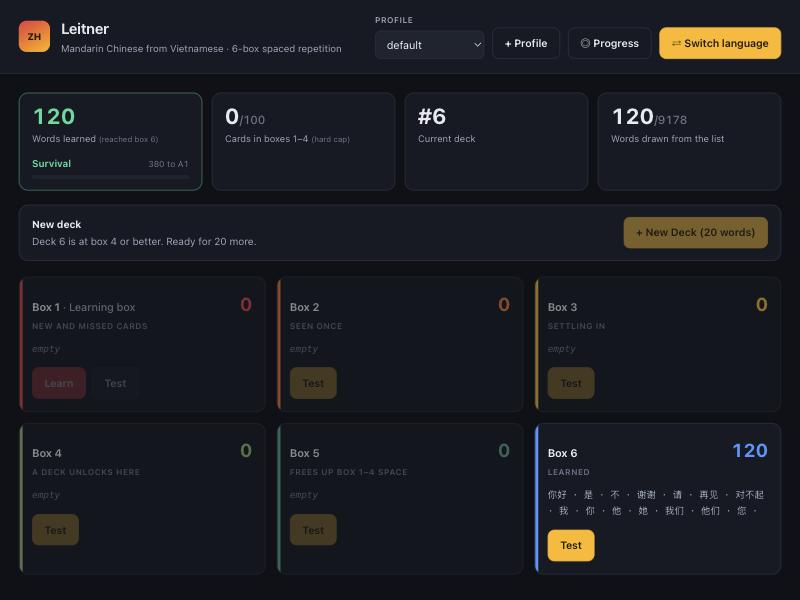
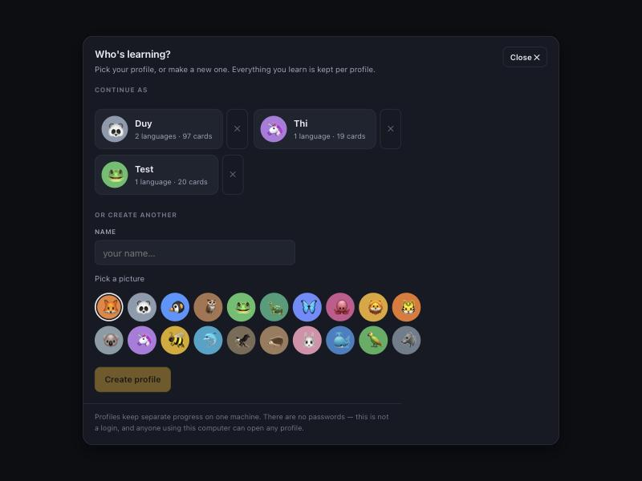
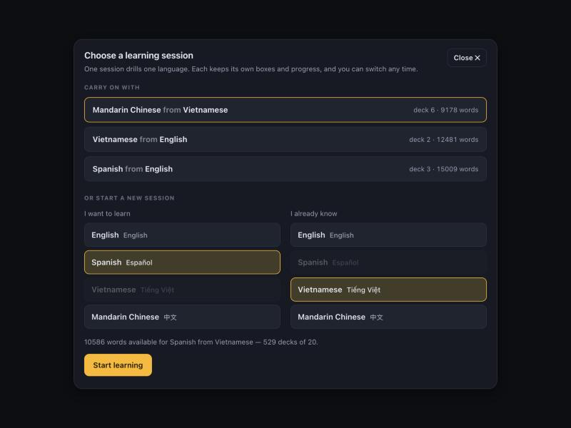
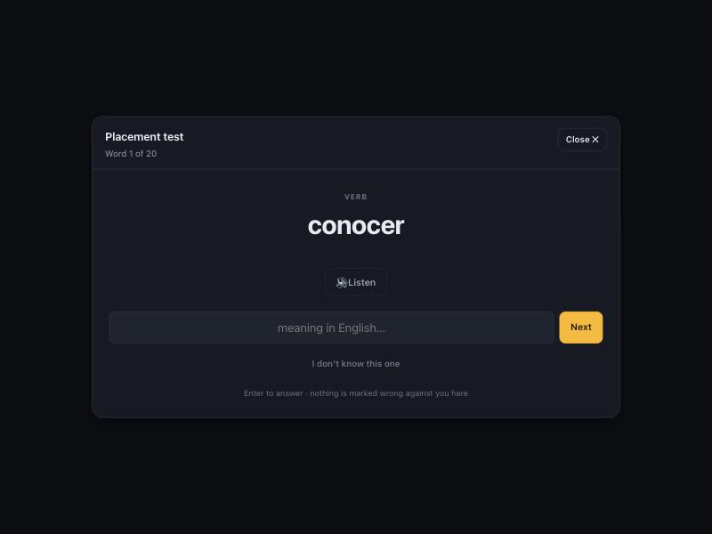
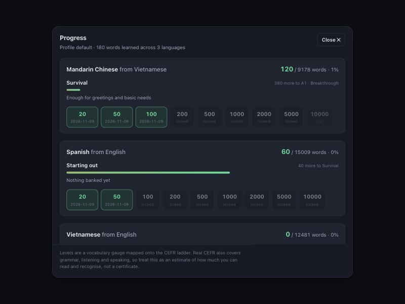

# Leitner

A local vocabulary trainer built on the 6-box
[Leitner system](https://en.wikipedia.org/wiki/Leitner_system). Choose a language to learn and
a language you already know — the pair is a *learning session* with its own boxes, progress
and proficiency meter.

**English · Spanish · Vietnamese · Mandarin Chinese**, in any direction.

Runs on your own machine. No account, no tracking, no API keys, and no internet once it's
running — including the audio.



| | |
|---|---|
| **Stack** | Python 3.7+, Flask, SQLite. One dependency. No build step, no framework, vanilla JS. |
| **Vocabulary** | 17,322 concepts; 9,288–15,116 words per language pair |
| **Audio** | your OS's own speech synthesis, offline, free |
| **Licence** | [MIT](LICENSE) for the code, [CC BY-SA 4.0](data/LICENSE) for the word data |

**Contents** — [Quick start](#quick-start) · [Opening the app](#opening-the-app) ·
[How it works](#how-it-works) · [Finding your level](#finding-your-level) ·
[Proficiency and milestones](#proficiency-and-milestones) · [Answer grading](#answer-grading) ·
[Audio](#audio) · [The word table](#the-word-table) · [Saved state](#profiles-and-saved-state) ·
[Project layout](#project-layout) · [Tests](#tests) · [Licence](#licence)

---

## Quick start

```bash
git clone <your-repo-url> leitner && cd leitner
python3 -m pip install -r requirements.txt
python3 app.py
```

Open <http://localhost:5100> and pick your languages.

Nothing else to set up — the word table ships in the repo, so there's no build step and no
dictionary download on first run. Use `--port 8000` to move it off 5100.

---

## Opening the app

The app opens by asking **who's learning** — pick an existing profile or make one with a
name and one of twenty pictures. Profiles keep entirely separate progress.



They are **not a login.** There are no passwords, and anyone at the keyboard can open any
profile. They exist so two people sharing a machine don't drill into each other's boxes.

Next you choose **which session to resume** — each row shows the deck you reached, how many
cards are in play, how many words you've learned and when you last touched it.



---

## Learning sessions

**One session drills one language.** Each keeps its own boxes, deck progress and learned
count; they share nothing. **⇄ Switch language** in the header moves between them or starts
another, and the header always shows the active pair.

Words available per pair — a pair only uses concepts that exist in **both** its languages:

| | English | Spanish | Vietnamese | Mandarin |
|---|---|---|---|---|
| **English** | — | 15,116 | 12,489 | 12,144 |
| **Spanish** | 15,116 | — | 10,759 | 10,408 |
| **Vietnamese** | 12,489 | 10,759 | — | 9,288 |
| **Mandarin** | 12,144 | 10,408 | 9,288 | — |

---

## How it works

Every new word starts in **box 1**. Answer correctly and the card moves up one box; miss it
and it drops straight back to box 1. A card that reaches **box 6** counts as learned.

**Box 1 has Learn and Test. Boxes 2–6 have Test only.**

- **Learn** walks through every card in box 1 — the word, its part of speech, its meaning,
  pinyin for Mandarin, and audio. Arrow keys move, space replays the audio. Reaching the end
  unlocks box 1's Test.
- **Test** shows a word in the language you're learning; you type the meaning in the language
  you know.

Box 1's Test stays locked until every box-1 card has been through Learn once. Cards that drop
back from a higher box don't re-lock it — you've already seen them.

**One wrong answer moves one card.** Missing a card in box 4 sends *that card* to box 1;
everything else in box 4 stays put.

**New Deck** loads the next 20 words, and the brake is a **40-card limit on each of boxes
1–4**. Boxes 5 and 6 are unlimited.

A deck lands in box 1, so box 1 is what gates it: a deck is offered only when a whole one
fits. With 36 cards in box 1 you are blocked, because 36 + 20 is 56. Clear box 1 by testing —
every card you get right moves up and makes room. A deck is never part-loaded to squeeze in.

That produces the loop the limit is for: load twenty, test them up, load twenty more.

**Retire this card** sits under each test verdict, for when a translation is wrong or
useless. The card leaves that session for good; the word table isn't touched.

---

## Finding your level

If you already know some of the language, starting at word 1 wastes weeks. **⚑ Level** offers
two ways past that.

**A 20-word placement test.** It samples across the whole frequency range — from the
commonest words to ones most natives would hesitate on — and asks what each means.



The bands line up with the level thresholds, so the questions land exactly where the answer
changes which level you are. Each band is judged on its own sample and credited that share of
its width, which is how a vocabulary-size test extrapolates from twenty questions. Simulated
against learners of a known size, the estimate tracks the truth to within about one band:

| Actually knows | Estimated |
|---|---|
| 0 | 0 |
| 500 | 500 |
| 2 000 | 2 000 |
| 8 000 | 8 500 |

That one-band spread is the honest limit of twenty questions, and the result screen says so
rather than presenting a precise-looking number. Skipping is the right move when you don't
know a word — the test is looking for where your vocabulary runs out, so guessing blurs it.

**Or set it by hand.** Pick a band from Starting out through C2 and new decks are drawn from
there.

Either way, setting a level only **moves where new decks are drawn from**. It does not mark
anything as learned: your milestones still count only words you have actually drilled, so a
placement can never award you badges you didn't earn. The proficiency meter does include the
placement, and the Progress panel shows the split — "2,000 estimated at placement, 150
learned here".

---

## Proficiency and milestones

**◎ Progress** in the header shows every language in your profile: how many words you've
learned, the milestones you've unlocked and when, and where that vocabulary puts you.



Milestones are **20, 50, 100, 200, 500, 1 000, 2 000, 5 000 and 10 000** words. The first is
one deck, so there's something to reach on day one. Each badge carries the date you hit it,
taken from the cards themselves — the date the *n*th word reached box 6. A milestone beyond
what a pair can offer is marked `n/a` rather than dangled as unreachable.

The meter maps vocabulary size onto the CEFR ladder:

| Words | Level | |
|---|---|---|
| 0 | Starting out | nothing banked yet |
| 100 | Survival | greetings and basic needs |
| 500 | A1 · Breakthrough | familiar everyday expressions |
| 1 000 | A2 · Waystage | routine exchanges on familiar matters |
| 2 000 | B1 · Threshold | most everyday conversation |
| 4 000 | B2 · Vantage | complex text and abstract topics |
| 7 000 | C1 · Advanced | fluent, flexible, implicit meaning |
| 10 000 | C2 · Mastery | virtually everything you read or hear |

**Read this as an estimate, not a certificate.** These are the usual rough word-count
estimates behind each CEFR band, but real CEFR also measures grammar, listening and speaking.
This meter only knows how many words you can recognise from a prompt.

---

## Answer grading

Lenient by design, and different per language:

| Answering in | What's accepted |
|---|---|
| English | case-insensitive; a leading *a / an / the* and the *to* of an infinitive are optional — `ser` takes "to be", "be", "To Be" |
| Spanish | accents and case optional; a leading article is optional — `water` takes "agua" or "el agua" |
| Vietnamese | **tone marks and diacritics optional** — "xin chào" and "xin chao" both pass, and `đ` may be typed `d` |
| Mandarin | the characters, **or** pinyin with or without tone marks and spaces — 你好, "nǐ hǎo", "ni hao", "nihao" |

Every listed meaning counts, so a concept glossed "autumn, fall" takes either, and
"to be (state, location)" also takes the bare "to be".

Dropping Vietnamese tone marks is a deliberate trade: tones change meaning, so this is more
forgiving than a teacher would be — but demanding `ầ` from a keyboard that can't easily type
it would make the app unusable. Same reasoning for accepting pinyin.

---

## Audio

Audio comes from your operating system's speech synthesis through the browser's Web Speech
API, in whichever language the session is teaching.

**Why this and not audio files:** it's free, there's nothing to download or generate, it works
offline, it covers every word in every language including ones you add, and it needs no API
key. Pre-generating audio would mean tens of thousands of files across four languages, a paid
TTS bill up front, and a regeneration step on every word-list change; a cloud TTS would add a
per-word cost and a network round trip. For single-word drilling the quality difference
doesn't justify either.

macOS ships a usable voice for all four — **Samantha** (en-US), **Mónica** (es-ES),
**Linh** (vi-VN), **Tingting** (zh-CN) — and the app picks the best one for the session's
language, remembering your choice per language. It prefers the OS default voice, then real
voices, and pushes macOS's joke voices (Bad News, Zarvox, Boing) and its older low-quality
ones to the bottom of the list. Open **Audio & settings** to change voice, speed, or turn off
automatic playback.

A card can list several accepted words — "hello, hi" — but audio speaks only the first, so a
card is never read out twice.

No voice for a language? On macOS: System Settings → Accessibility → Spoken Content →
System Voice → Manage Voices, add one, reload. Everything else works without it.

---

## The word table

`data/concepts.json` holds **17,322 concepts**. A concept is one meaning carrying a word in
each language at once:

```json
{"id": 0, "en": ["hello","hi"], "es": ["hola"], "vi": ["xin chào"],
 "zh": ["你好"], "pinyin": "nǐ hǎo", "pos": "interj", "src": "core"}
```

That shape is the reason any pair works off one table: a card is the same idea whichever way
you drill it, and a fifth language is a new column rather than a set of new bilingual lists.
Concepts are ordered most-common-first.

**The first 365 are hand-written** in `data/core_concepts.tsv`, a pipe-separated file you can
edit: greetings, pronouns, the top verbs, function words, everyday nouns, numbers, days,
months, colours, adjectives and common phrases, in all four languages. Spanish nouns carry
their article (`el perro`), Mandarin carries tone-marked pinyin, Vietnamese nouns are bare
without a classifier. That's 18 decks — months of study at twenty cards at a time.

**The rest are generated** by `build_concepts.py` from four public sources:

| Source | Role | Licence |
|---|---|---|
| [hermitdave/FrequencyWords](https://github.com/hermitdave/FrequencyWords) | concept ordering and word choice | MIT |
| [English Wiktionary translation tables](https://kaikki.org/dictionary/English/) (~4k words) | **sense-aligned** translations, used first where they exist | CC BY-SA 4.0 |
| [FreeDict `eng-spa`](https://freedict.org) (~64k headwords) | Spanish | CC BY-SA 3.0 |
| [CC-CEDICT](https://www.mdbg.net/chinese/dictionary?page=cc-cedict) (~120k entries) | Mandarin, with pinyin | CC BY-SA 4.0 |
| [Vietnamese Wiktionary via kaikki.org](https://kaikki.org/viwiktionary/) (~123k entries) | Vietnamese | CC BY-SA 4.0 |

**Why two layers.** The per-language dictionaries each translate an English
*word*, and each picks a sense of its own — so for a word with several meanings they can
disagree completely. "john" once produced Spanish *putero*, Vietnamese *nhà vệ sinh* (toilet)
and Chinese 约翰 (the name): three unrelated senses on one card. English Wiktionary's
translation tables instead give translations of one English **sense**, with Spanish,
Vietnamese and Mandarin together, which removes that failure entirely. They only cover about
4,000 English words — far too few to be the primary source — but those are the common ones,
so they are applied first and the per-language dictionaries fill in the rest. 2,494 concepts
currently come from the sense-aligned layer, and `data/sense_translations.json` ships in the
repo (300 KB) so no 3.4 GB download is needed to rebuild.

Candidates are ranked by **reverse consistency** first — if the entry for "girl" lists `chica`
as *its* primary translation, "girl" beats "bird" even though "bird" is the commoner English
word — then by corpus frequency. The builder also drops proper nouns, profanity, archaic
glosses, English function words and irregular inflections, conjugated forms that land on a
wrong homograph, and plural/gender/accent duplicates of words already in the table.

### Known limits

- **The generated tier is not hand-checked.** Accuracy is good but not perfect, and the
  further down the list you go the likelier an odd or over-literal sense. That's what
  **Retire this card** is for.
- **Filtered out, because each was producing real nonsense:** people's names (an English
  frequency list is full of them, and "john", "paul", "peter" were all producing cards),
  Chinese transliterations of those names, Wiktionary's grammar notes used as a translation
  ("decorations" → "số nhiều của decoration", *plural of decoration*), and profanity in any
  language — the profanity check previously only looked at the English side, which is how
  *putero* got onto a card.
- **Vietnamese comes from the Vietnamese Wiktionary, not the English one.** Its English
  section defines 123k English headwords *in* Vietnamese — four times the size of the reverse
  direction and markedly more accurate. The English Wiktionary's Vietnamese section was tried
  first and dropped: its ranking favoured Sino-Vietnamese literary morphemes over everyday
  words (`small → em`, `tree → thụ`, instead of `nhỏ` and `cây`). Vietnamese is still the
  smallest of the four, so Vietnamese–Mandarin is the one pair below 10,000 words.
- **Generated nouns carry no article or classifier** — the sources have no gender field, and
  guessing from a word ending would teach wrong genders.
- **Mandarin is simplified characters.** CC-CEDICT carries traditional too; the builder keeps
  simplified to match the frequency list.

### Rebuilding or extending

```bash
python3 build_concepts.py                 # everything the sources support (the default)
python3 build_concepts.py --limit 4000    # stop at 4,000 words per language
python3 build_concepts.py --core-only     # no network, the 365 curated concepts only
```

`--limit` is a target *per language*, not a total. The default of 0 means no target: the build
runs the whole frequency list and takes whatever the dictionaries fill. Sources are cached in
`.wordlist-cache/` (~126 MB) on first run; it's gitignored and safe to delete.

To fix a translation, add or edit a row in `data/core_concepts.tsv` and rebuild — core rows
take precedence over anything generated. Columns may be left empty if you only know some of
the languages (`sky||bầu trời|||noun` is valid); a pair just skips concepts missing one of its
two sides.

Cards are stored by concept id, so rebuilding with the same ordering is safe. Changing the
*order* of existing concepts would reshuffle what's in your boxes, so reset the session if you
reorder.

**Adding a fifth language** needs a frequency list, one dictionary mapping it to English, a
loader in `build_concepts.py`, a column in the TSV, and an entry in `LANGUAGES` in `app.py`.
When a language looks weak the dictionary is usually the problem rather than the ranking —
Vietnamese went from 6,885 words to 12,489 purely by swapping the source.

---

## Profiles and saved state

Everything lives in `data/leitner.db` (SQLite): every session, which box each card is in, deck
progress, right/wrong counts, retired cards, milestone dates, and how far into the word list
each session has drawn. It survives reloads, restarts and switching browsers.

The avatar button in the header switches profile; creating and deleting live in the same
panel. Each profile has its own independent set of sessions.

**Deleting a profile removes everything it has learned** — its sessions, its cards and its
milestones — and there is no undo. So the ✕ beside a profile asks first, and names exactly
what is about to go ("1 language, 20 cards in play, 20 words learned"). Past 20 words learned
it also asks you to type the profile name, because by then there is enough in it to be worth
a deliberate second step.
**Reset this learning session** under Audio & settings wipes one language pair back to word 1;
your other languages and the word table are untouched.

To back up your progress, copy `data/leitner.db`. It is gitignored — your progress is yours
and never gets committed.

---

## Project layout

| Path | What |
|---|---|
| `app.py` | Flask server, SQLite schema, profiles, sessions, box rules, per-language grading, placement test, levels and milestones, 17 JSON endpoints |
| `build_concepts.py` | Builds `data/concepts.json` from the curated core plus the four sources |
| `data/core_concepts.tsv` | The 365 hand-written concepts — edit this to fix or add words |
| `data/concepts.json` | 17,322 generated concepts (committed, so no build is needed) |
| `data/sense_translations.json` | sense-aligned translations for ~4k common words, applied first |
| `data/leitner.db` | Your progress (created on first run, gitignored) |
| `templates/index.html` | The UI — boxes, Learn/Test overlay, profile gate, session picker, level and progress panels |
| `static/app.js` | Rendering, profile gate, session picker, Learn/Test/placement flows, speech synthesis |
| `static/style.css` | Hand-written, CSS variables at the top, light and dark |
| `tests/test_rules.py` | The test suite |

Settings worth knowing, at the top of `app.py`:

```python
DECK_SIZE = 20          # cards drawn per deck
BOX_CAP = 40            # max cards in any one of boxes 1-4
ACTIVE_MAX_BOX = 4      # boxes 1..4 are capped; 5 and 6 are unlimited
MILESTONES = (20, 50, 100, 200, 500, 1000, 2000, 5000, 10000)
LEVELS = (...)          # words -> CEFR band
PLACEMENT_QUESTIONS = 20
PLACEMENT_EDGES = (...) # frequency bands the placement test samples
AVATARS = (...)         # the twenty profile pictures
LANGUAGES = {...}       # code -> display name, native name, speech-synthesis tag
```

---

## Tests

```bash
python3 tests/test_rules.py
```

184 checks against a throwaway database: the concept table and every language pair, grading in
all four languages (including Vietnamese tone-stripping and Mandarin pinyin), session creation
and isolation, the Learn gate, promotion and demotion, the new-deck gate, the per-box limit,
the learned counter, the per-box limit, proficiency levels, milestone unlocking and dates, the text sent to
audio, the placement test's bands and estimator, manual level setting, deck drawing after the
start point moves, profile creation, deletion and isolation, retiring, and reset. No network, no fixtures to install.

---

## Licence

**Code — [MIT](LICENSE).** Do what you like with it.

**Word data — [CC BY-SA 4.0](data/LICENSE).** `data/concepts.json` is built from Creative
Commons BY-SA dictionaries, so it is a derivative work and carries share-alike obligations:
if you redistribute it, keep the licence and the attributions in [`data/LICENSE`](data/LICENSE),
and release your changes under CC BY-SA 4.0. This is a different licence from the code, and
the distinction is deliberate — see [`data/LICENSE`](data/LICENSE) for the full attribution
list and for how to hold the code alone.
