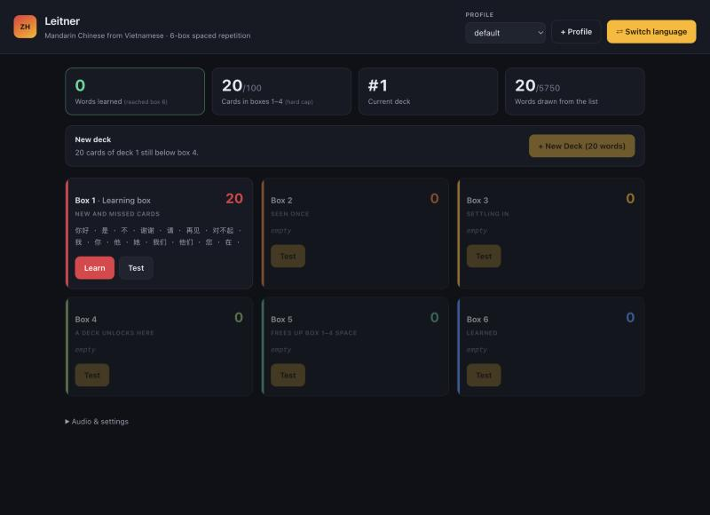

# Leitner

A local web app for learning vocabulary with a 6-box
[Leitner](https://en.wikipedia.org/wiki/Leitner_system) system. Pick a language to learn and
a language you already know — the pair is a **learning session** with its own boxes and
progress. Flask + SQLite, no accounts, no internet needed once it's running.

**English · Spanish · Vietnamese · Mandarin Chinese**, in any direction.



---

## Run it

```bash
cd ~/Desktop/SpanishVocab && python3 app.py
```

Then open <http://localhost:5100>.

The only dependency is Flask. If `python3 -c "import flask"` fails:

```bash
python3 -m pip install flask
```

Change the port with `python3 app.py --port 8000`.

---

## Learning sessions

On first load you choose what to learn and what you already know. **One session drills one
language.** Each session keeps its own boxes, deck progress and learned count — they share
nothing — and **⇄ Switch language** in the header moves between them or starts another.


Any of the four languages can be either side, so Mandarin from Vietnamese, English from
Spanish and Spanish from English are three separate, independent sessions.

Words available per pair — each pair only uses concepts that exist in **both** languages:

| | English | Spanish | Vietnamese | Mandarin |
|---|---|---|---|---|
| **English** | — | 15,009 | 12,489 | 12,102 |
| **Spanish** | 15,009 | — | 10,586 | 10,213 |
| **Vietnamese** | 12,489 | 10,586 | — | 9,185 |
| **Mandarin** | 12,102 | 10,213 | 9,185 | — |

Every pair clears 10,000 words except Vietnamese–Mandarin at 9,185, which is the ceiling of
the two source dictionaries overlapping — see [The word table](#the-word-table).

---

## How it works

**Six boxes.** Every new word starts in box 1. Answer correctly and the card moves up one
box; miss it and it drops straight back to box 1. A card that reaches box 6 counts as
learned, and the counter at the top tracks that.

**Box 1 has Learn and Test. Boxes 2–6 have Test only.**

- **Learn** walks you through every card in box 1 — the word, its part of speech, its
  meaning, pinyin if you're learning Mandarin, and audio. Arrow keys move, space replays the
  audio. Reaching the end unlocks box 1's Test button.
- **Test** shows a word in the language you're learning and asks you to type the meaning in
  the language you know. Correct → up a box. Wrong → back to box 1.

Box 1's Test stays locked until every box-1 card has been through Learn once. Cards that
drop back down from a higher box don't re-lock it — you've already seen them.

**One wrong answer moves one card.** Missing a card in box 4 sends *that card* to box 1;
everything else in box 4 stays put.

**New Deck** loads the next 20 words. It unlocks when two things are true:

1. every card of your current deck has reached **box 4 or higher**, and
2. boxes 1–4 together hold **no more than 100 cards**.

The second rule is the brake. Five decks of 20 fill the 100-card allowance, and the only way
to make room is to promote cards into boxes 5 and 6 — that is, to actually learn them. The
New Deck bar always says which condition is holding you up.

**Retire this card** sits under each test verdict. Use it when a translation is wrong or
useless: the card leaves that session for good. The word table isn't touched.

### Answer grading

Lenient by design, and per language:

| Answering in | What's accepted |
|---|---|
| English | case-insensitive; a leading *a / an / the* and the *to* of an infinitive are optional — `ser` takes "to be", "be", "To Be" |
| Spanish | accents and case optional; a leading article is optional — `water` takes "agua" or "el agua" |
| Vietnamese | **tone marks and diacritics optional** — "xin chào" and "xin chao" both pass, and `đ` may be typed `d` |
| Mandarin | the characters, **or** pinyin with or without tone marks and spaces — 你好, "nǐ hǎo", "ni hao" and "nihao" all pass |

Every listed meaning counts, so a concept glossed "autumn, fall" accepts either, and
"to be (state, location)" also accepts the bare "to be".

Dropping Vietnamese tone marks is a deliberate trade: tones change meaning, so this is more
forgiving than a Vietnamese teacher would be, but demanding `ầ` from a keyboard that can't
easily type it would make the app unusable. The same reasoning allows pinyin for Mandarin.

---

## Audio

Audio comes from your Mac's own speech synthesis through the browser's Web Speech API, in
whichever language the session is teaching.

**Why this and not audio files:** it's free, there's nothing to download or generate, it
works offline, it covers every word in every language including any you add later, and it
needs no API key. Pre-generating audio would mean tens of thousands of MP3s across four
languages, a paid TTS bill up front, and a regeneration step on every word-list change; a
cloud TTS would add a per-word cost and a network round trip. For single-word drilling the
quality difference doesn't justify either.

macOS ships a usable voice for all four: **Samantha** (en-US), **Mónica** (es-ES),
**Linh** (vi-VN) and **Tingting** (zh-CN). The app picks the plainly-named voice matching the
session's language ahead of the novelty voices, and remembers your choice per language. Open
**Audio & settings** to change the voice, speed, or turn off automatic playback.

If a language has no voice: System Settings → Accessibility → Spoken Content → System Voice →
Manage Voices, add one, then reload. Everything else works without it.

---

## The word table

`data/concepts.json` holds **17,413 concepts**. A *concept* is one meaning carrying a word in
each language:

```json
{"id": 0, "en": ["hello","hi"], "es": ["hola"], "vi": ["xin chào"],
 "zh": ["你好"], "pinyin": "nǐ hǎo", "pos": "interj", "src": "core"}
```

Because every concept holds all languages at once, a card is the same idea whichever
direction you drill it, and adding a language later means adding a column rather than
building new bilingual lists. Concepts are ordered most-common-first, and a pair's deck pool
is the concepts that have a word on both sides.

**The first 365 concepts are hand-written**, in `data/core_concepts.tsv` — a plain
pipe-separated file you can edit. Clean one-sense words in all four languages: greetings,
pronouns, the top verbs, function words, everyday nouns, numbers, days, months, colours,
adjectives and common phrases. Spanish nouns carry their article (`el perro`), Mandarin
carries tone-marked pinyin, Vietnamese nouns are given bare without a classifier. That's 18
decks — realistically months of study under the 100-card cap.

**The rest are generated** by `build_concepts.py` from four public sources:

| Source | Role |
|---|---|
| [hermitdave/FrequencyWords](https://github.com/hermitdave/FrequencyWords) (OpenSubtitles 2018) | concept ordering, and word choice within each language |
| [FreeDict `eng-spa`](https://freedict.org) (~64k headwords) | Spanish |
| [CC-CEDICT](https://www.mdbg.net/chinese/dictionary?page=cc-cedict) (~120k entries) | Mandarin, with pinyin |
| [Vietnamese Wiktionary via kaikki.org](https://kaikki.org/viwiktionary/) (~123k entries) | Vietnamese |

Candidate words are ranked by **reverse consistency** first — if the entry for "girl" lists
`chica` as *its* primary translation, "girl" wins over "bird" even though "bird" is the
commoner English word — and by corpus frequency second. The builder also drops proper nouns,
profanity, archaic glosses, English function words and irregular inflections, conjugated
forms that land on a wrong homograph, and plural/gender/accent duplicates of words already in
the table.

**Known limits, worth reading before you trust a card:**

- **The generated tier is not hand-checked.** Accuracy is good but not perfect, and the
  further down the list you go the more likely an odd or over-literal sense. That's what
  **Retire this card** is for.
- **Vietnamese comes from the Vietnamese Wiktionary, not the English one.** Its English
  section defines 123k English headwords *in* Vietnamese, which is both four times the size
  of the reverse direction and markedly more accurate: the English Wiktionary's Vietnamese
  section was tried first and dropped, because its ranking favoured Sino-Vietnamese literary
  morphemes over everyday words (`small → em`, `tree → thụ`, instead of `nhỏ` and `cây`).
  Vietnamese is still the smallest of the four, so Vietnamese–Mandarin is the one pair below
  10,000.
- **Generated nouns carry no article or classifier** — the sources have no gender field, and
  guessing from a word ending would teach wrong genders.
- **Mandarin is simplified characters.** CC-CEDICT carries traditional too; the builder keeps
  simplified to match the frequency list.

### Rebuilding or extending

```bash
python3 build_concepts.py                 # the default: everything the sources support
python3 build_concepts.py --limit 4000    # stop at 4,000 words per language
python3 build_concepts.py --core-only     # no network, the 365 curated concepts only
```

`--limit` is a target *per language*, not a total: the table grows until every language
reaches it. The default of 0 means no target, so the build runs the whole frequency list and
takes whatever the dictionaries can fill. Sources are cached in `.wordlist-cache/` (~126 MB)
on first run; the directory is gitignored and safe to delete.

To fix a translation, add or edit a row in `data/core_concepts.tsv` and rebuild — core rows
take precedence over anything generated. Columns may be left empty if you only know some of
the languages (`sky||bầu trời|||noun` is a valid row); a pair simply skips concepts that are
missing one of its two sides. Cards are stored by concept id, so rebuilding with the same
ordering is safe; changing the *order* would reshuffle what's in your boxes, so reset the
session if you reorder.

When a language looks weak, the dictionary is usually the problem rather than the ranking —
Vietnamese went from 6,885 words to 12,489 purely by swapping the source. To add a fifth
language you need a frequency list and one dictionary mapping it to English,
then a loader in `build_concepts.py`, a column in the TSV, and an entry in `LANGUAGES` in
`app.py`.

---

## Profiles and saved state

Everything lives in `data/leitner.db` (SQLite): every session, which box each card is in,
deck progress, right/wrong counts, retired cards, and how far into the word list each session
has drawn. It survives reloads, restarts and switching browsers.

Use **+ Profile** for a second learner; each profile has its own independent set of sessions.
**Reset this learning session** under Audio & settings wipes one language pair and starts it
again from word 1 — your other languages and the word table are untouched.

To back up your progress, copy `data/leitner.db`.

---

## Files

| File | What |
|---|---|
| `app.py` | Flask server, SQLite schema, sessions, promotion/demotion rules, per-language grading, 10 JSON endpoints |
| `build_concepts.py` | Builds `data/concepts.json` from the curated core plus the four sources |
| `data/core_concepts.tsv` | The 365 hand-written concepts — edit this to fix or add words |
| `data/concepts.json` | 17,413 concepts (generated) |
| `data/leitner.db` | Your progress (created on first run) |
| `templates/index.html` | The UI — six boxes, the Learn/Test overlay, the language picker |
| `static/app.js` | Rendering, session picker, Learn walkthrough, Test round, speech synthesis |
| `static/style.css` | Hand-written, CSS variables at the top, light and dark |

Settings worth knowing, at the top of `app.py`:

```python
DECK_SIZE = 20          # cards drawn per deck
ACTIVE_CAP = 100        # hard cap on cards in boxes 1-4
NEW_DECK_MIN_BOX = 4    # every deck card must reach this box
LANGUAGES = {...}       # code -> display name, native name, speech-synthesis tag
```

---

## Tests

```bash
python3 tests/test_rules.py
```

58 checks over a throwaway database: the concept table and every language pair, grading in
all four languages (including Vietnamese tone-stripping and Mandarin pinyin), session
creation and isolation, the Learn gate, promotion and demotion, the new-deck gate, the
100-card cap, the learned counter, retiring, reset, and profiles.
